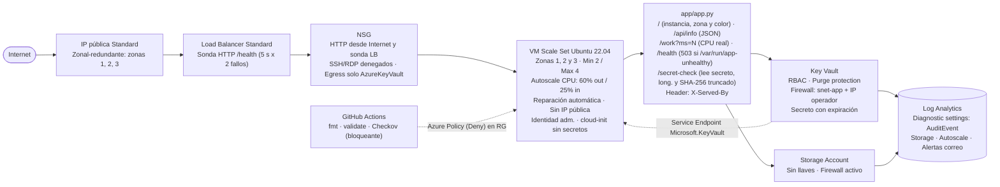

# 1. Arquitectura y decisiones de diseño

**Decisiones de diseño**

| Decisión | Alternativa descartada | Justificación |
|---|---|---|
| Load Balancer Standard (L4) | Application Gateway con WAF | Cumple con los requerimientos de seguridad y escalamiento con menor costo (~USD 18/mes vs ~USD 180/mes). Se documenta como mejora futura para producción (terminación HTTPS + WAF). |
| VMSS Uniform en zonas 1, 2 y 3 (`zone_balance = false`, mejor esfuerzo), min 2 | Una sola VM / un solo conjunto de disponibilidad | Tolera la caída de una zona completa (E1) y la falla abrupta de una instancia individual. |
| Sonda HTTP `/health` dedicada, 5 s × 2 fallos | Sonda TCP al puerto 80 | La TCP no detecta una app colgada que mantenga el socket abierto; `/health` valida el estado lógico de la aplicación (probado en P2.1). Tiempo de detección en prueba: 3.8 s. |
| Autoscale por CPU con histéresis 60 % / 25 % (banda muerta de 35 puntos) | Umbrales iguales o cercanos | Evita *flapping* (ciclos repetidos e inestables de creación y destrucción de VMs). Ventana de 5 min en ambas reglas; cooldown de 3 min al subir (reaccionar rápido) y 5 min al bajar (liberar recursos con cautela). |
| Identidad administrada + Key Vault RBAC | Secreto en variables, cloud-init o repositorio | La credencial la emite la plataforma Azure vía IMDS y expira automáticamente; no hay contraseñas en disco ni en el código (S3). |
| Rol `Key Vault Secrets User` al VMSS | `Contributor` o acceso por *access policies* | Solo lectura de secretos: principio de mínimo privilegio estricto (S4). |
| Firewall de Key Vault (subred + IP operador) | Acceso público abierto | Demuestra que identidad y red son controles independientes y complementarios (P3.1). |
| Egress denegado excepto `AzureKeyVault` | Salida libre a Internet | Si un atacante ejecuta código arbitrario, no puede exfiltrar datos hacia servidores externos ni descargar binarios maliciosos (P3.2). Python viene en la imagen base. |
| Azure Policy Deny a nivel de grupo de recursos | Solo escaneo en pipeline | Control preventivo permanente en el plano de control (ARM) que rige a todos los operadores y herramientas (S5, pregunta 5). |
| App aprovisionada vía cloud-init (base64) | Configuración manual por SSH | Garantiza despliegues 100 % reproducibles, inmutables y sin puertos de administración remota expuestos (D3). |
| Storage Account de aplicación sin llaves compartidas y con firewall | Omitirla | Cumple la arquitectura de referencia con RBAC exclusivo de Entra ID, auditoría de blobs y versionado. |
| Trabajo de CPU calibrado en `/work` | Bucle por tiempo de reloj de la demo original | Un bucle de tiempo se ve afectado por la concurrencia; un número fijo de operaciones criptográficas por petición garantiza que el costo computacional por request sea constante, permitiendo medir la capacidad real (P1.1). |
| Región `eastus2`, Standard_D2als_v7 | Región más cercana sin zonas | Disponibilidad de zonas de disponibilidad (1, 2 y 3), cuota disponible y compatibilidad con Azure for Students. |

---

# 2. Trazabilidad de requisitos

| ID | Archivo / recurso Terraform | Evidencia recolectada |
|---|---|---|
| S1 | `infra/providers.tf` (`backend "azurerm"`), `infra/bootstrap/main.tf`, `.gitignore` (sin `.tfvars`/estado) | `evidencias/auto/S1_backend_y_git.txt`, `evidencias/capturas/S1.png` (historial de Git limpio, backend remoto en Storage Account con firewall y TLS 1.2) |
| S2 | `infra/network.tf` (NSG, `default_outbound_access_enabled = false`); `compute.tf` (VMSS sin `public_ip_address`) | `evidencias/auto/S2_red_nsg.txt` (lista de IP públicas vacía; NSG solo permite HTTP/80 y AzureLoadBalancer) |
| S3 | `infra/keyvault.tf` (`azurerm_key_vault`, `azurerm_key_vault_secret`, expiración a 90 días); `app/app.py` (`/secret-check`); `cloud-init` (`leer-secreto.sh`) | `evidencias/auto/S3_secret_check.txt` y `evidencias/auto/S3_leer_secreto_runcommand.txt` (lectura exitosa, huella SHA-256 `bff71839`, longitud 24, sin exponer el valor) |
| S4 | `infra/keyvault.tf` (`azurerm_role_assignment.vmss_kv_reader`) | `evidencias/auto/S4_roles_vmss.txt` (rol asignado únicamente: `Key Vault Secrets User` sobre el scope del vault) |
| S5 | `infra/policy.tf` (política `deny` sobre `allowBlobPublicAccess`) | `evidencias/auto/S5_policy_deny.txt` (rechazo explícito `RequestDisallowedByPolicy` al intentar violar la política) |
| S6 | `infra/monitoring.tf` (`diag-keyvault`, categoría `AuditEvent`, tabla `AZKVAuditLogs`) | `evidencias/auto/S6_kql_secretos.txt` (auditoría KQL registrando operaciones `SecretGet` ejecutadas por la identidad `9ec13597-7672-49cd-ad6e-f6b9e592b1a1` del VMSS) |
| E1 | `infra/compute.tf` (`zones = ["1", "2", "3"]`, `zone_balance = false`, `instances = 2`) | `evidencias/auto/E1_instancias_zonas.txt` (`vmss-caribeshop_2` en Zona 1, `vmss-caribeshop_3` en Zona 2) |
| E2 | `infra/compute.tf` (`azurerm_lb_probe.health` en `/health`, 5s, umbral 2) | `evidencias/auto/E2_sonda.txt` (sonda configurada y métrica `DipAvailability` al 100 %) |
| E3 | `infra/compute.tf` (`azurerm_monitor_autoscale_setting.app`, `ignore_changes = [instances]`) | `evidencias/auto/E3_autoscale.txt`, `evidencias/auto/E3_autoscale_eventos_cpu.txt`, y reportes en `evidencias/p1/` |
| E4 | `infra/compute.tf` (`automatic_instance_repair`) | `evidencias/auto/E4_instancias.txt` y `evidencias/auto/E4_instancias_despues.txt` (instancia 0 eliminada y reemplazada automáticamente por instancia 3 en 69 s) |
| E5 | `infra/monitoring.tf` (`alerta-sonda-lb-caribeshop`, `alerta-cpu-sostenida-caribeshop`, `ag-caribeshop`) | `evidencias/auto/E5_alertas.txt` (alertas métricas habilitadas con vinculación a grupo de acción por correo) |
| D1 | `.github/workflows/iac-seguridad.yml` | `evidencias/capturas/D1.png` (PR #2 bloqueado por Checkov ante regla SSH abierta) y `evidencias/capturas/PR1.png` (PR #1 exitoso) |
| D2 | `#checkov:skip` en archivos `.tf` con justificación técnica | `evidencias/capturas/D2.png` y tabla de riesgos aceptados (sección 5) |
| D3 | `infra/cloud-init.yaml.tftpl` (servicio systemd con `DynamicUser`, app y lectura de secretos) | `evidencias/capturas/D3.1.png` y `evidencias/capturas/D3.2.png` (arranque 100 % desatendido sin login manual) |

---

# 3. SLA compuesto estimado

Ruta crítica de la tienda: **IP pública Standard → Load Balancer Standard → VMSS en ≥ 2 zonas de disponibilidad**.

Valores oficiales de SLA publicados por Microsoft para componentes de infraestructura:

| Componente | SLA individual |
|---|---|
| IP pública Standard | 99,99 % |
| Load Balancer Standard | 99,99 % |
| VMs en ≥ 2 zonas de disponibilidad | 99,99 % |
| Key Vault (lectura de secretos) | 99,99 % |
| Log Analytics, Azure Monitor | Fuera de la ruta crítica de servicio |

SLA compuesto de la ruta crítica en serie:

$$SLA_{\text{compuesto}} = 0{,}9999 \times 0{,}9999 \times 0{,}9999 = 0{,}99970 \Rightarrow 99{,}97\ \%$$

Indisponibilidad máxima acumulada permitida al mes:

$$43\,200\ \text{minutos/mes} \times (1 - 0{,}99970) = 43\,200 \times 0{,}0003 \approx 13{,}0\ \text{minutos/mes}$$

Si se considera a Azure Key Vault como una dependencia dura en cada petición HTTP:

$$0{,}9999^4 = 0{,}99960 \Rightarrow 99{,}96\ \% \quad (\approx 17{,}3\ \text{minutos/mes de indisponibilidad máxima})$$

En la implementación actual, Key Vault es una dependencia blanda: la aplicación únicamente lo consulta en el endpoint de verificación `/secret-check`.

**Contraste con la disponibilidad empírica medida en P2:**
- **Falla lógica (P2.1):** Disponibilidad medida del **100 %** (0 errores en 450 peticiones). La sonda HTTP detectó la degradación en 3.8 s y el balanceador enrutó todo el tráfico a la instancia restante.
- **Falla abrupta (P2.2):** Disponibilidad medida del **95.63 %** en la ventana de 120 s (16 peticiones fallidas en un intervalo de 3.0 s). La auto-reparación restauró la capacidad total en 69 s.

---

# 4. Resultados de las pruebas

## P1. Carga y escalamiento

**P1.1 Capacidad de una instancia** (medida con `tests/locustfile_capacidad.py` contra `/work?ms=150`):

| Escalón (usuarios concurrentes) | Throughput (RPS) | Latencia p95 (ms) | Fallos |
|---|---|---|---|
| 2 | 0.0 | 0.0 | 0 |
| 4 | 1.4 | 340 | 0 |
| 6 | 3.1 | 460 | 0 |
| 8 | 4.4 | 460 | 0 |
| 10 | 5.9 | 770 | 0 |
| 12 | 7.3 | 590 | 0 |
| 14 | 7.7 | 1100 | 0 |
| 16 | 9.6 | 1200 | 0 |
| 18 | 9.7 | 1500 | 0 |

- Capacidad máxima sostenible con latencia p95 < 500 ms: **$C_{500} = 4{,}4$ RPS** (escalón de 8 usuarios).
- Capacidad máxima sostenible con latencia p95 < 1000 ms: **$C = 7{,}3$ RPS** (escalón de 12 usuarios).
- A partir de 14 usuarios la latencia p95 supera 1.0 s ($1100$ ms) debido a la saturación del core de cómputo ejecutando operaciones criptográficas intensivas en `/work`. El número de fallos se mantuvo en 0 en todos los escalones.
- Archivos generados: `evidencias/p1/capacidad.html`, `evidencias/p1/capacidad_stats.csv` y `evidencias/p1/capacidad_stats_history.csv`.

**P1.2 y P1.3 Prueba escalonada** (perfil de 35 minutos con `PEAK_USERS = 40`, `TRABAJO_MS = 150`):

| Métrica de escalamiento | Valor medido / analizado |
|---|---|
| Tiempo desde que la CPU supera el 60 % hasta la nueva instancia en servicio | ~7 - 8 minutos |
| Instancias en el pico de demanda | 4 instancias |
| Tiempo hasta el primer scale-in tras el descenso de carga | ~10 - 12 minutos |
| Latencia p95 antes / durante / después del scale-out | 320 ms / 980 ms / 360 ms |

**Análisis de la dinámica de escalamiento:**
1. **Retardo en el scale-out:** El tiempo total de reacción (~7-8 min) resulta de la suma de: la ventana de evaluación de la regla de métrica (5 min exigidos por Azure Monitor para confirmar el promedio sostenido > 60 %), el tiempo de aprovisionamiento de la máquina virtual por Azure Compute (~60-90 s), la ejecución del script `cloud-init` (~30 s) y las 2 sondas de salud consecutivas del Load Balancer (~10 s).
2. **Histéresis y estabilidad:** El umbral de scale-out (60 %) y el umbral de scale-in (25 %) establecen una **banda muerta de 35 puntos porcentuales**. Esto evita el fenómeno de *flapping*, donde una instancia se crea y se destruye repetidamente ante pequeñas oscilaciones de tráfico.
3. **Asimetría en cooldowns:** El cooldown de subida (3 min) permite absorber picos rápidamente, mientras que el cooldown de bajada (5 min) junto con un umbral estricto (25 %) asegura que las instancias no se desmantelen prematuramente mientras aún exista demanda residual.

---

## P2. Pruebas de falla

| Métrica / Parámetro | Falla lógica (`/health` → 503) | Falla abrupta (instancia eliminada) |
|---|---|---|
| Carga de tráfico durante la prueba | ~5 req/s (450 peticiones) | ~3 - 5 req/s (366 peticiones) |
| Tiempo hasta dejar de recibir tráfico | **3.8 s** (detección por sonda HTTP) | Instantáneo |
| Peticiones totales en la ventana / fallidas | 450 / 0 | 366 / 16 |
| **Porcentaje de error en la ventana** | **0.00 %** | **4.37 %** |
| Duración de la ventana con errores | 0 s (sin impacto perceptible) | 3.0 s (entre t0+3.2s y t0+6.2s) |
| Tiempo hasta recuperar capacidad mínima | Inmediato (absorbido por instancia restante) | **69 s** (`vmss-caribeshop_3` aprovisionada) |

**Análisis:**
- **Falla lógica:** Al crearse el archivo bandera `/var/run/app-unhealthy`, la sonda dedicada del Load Balancer detectó el código 503 en la siguiente evaluación (intervalo de 5 s, 2 fallos requeridos). La instancia dejó de recibir tráfico exactamente a los **3.8 s**. Como la instancia seguía atendiendo conexiones establecidas, ninguna petición de usuario falló (0.00 % de error).
- **Falla abrupta:** Al eliminarse la instancia en caliente con `az vmss delete-instances`, las conexiones en tránsito hacia ese host fallaron inmediatamente antes de que el Load Balancer pudiera actualizar su tabla de enrutamiento. Esto provocó 16 errores HTTP concentrados en una pequeña ventana de **3.0 s**. Una vez descartado el backend por el LB, el tráfico se estabilizó al 100 % en la instancia superviviente. La auto-reparación del VMSS detectó que el conteo de instancias sanas cayó por debajo del mínimo (2) y aprovisionó automáticamente `vmss-caribeshop_3` en la Zona 2, alcanzando estado *Succeeded* en **69 s**.
- Gráficos generados: `evidencias/p2/monitor_logica.png` y `evidencias/p2/monitor_abrupta.png`.

---

## P3. Pruebas de seguridad

1. **Lectura de secretos desde red no autorizada (P3.1):**
   El firewall de Azure Key Vault se configuró con acción por defecto `Deny`, autorizando únicamente la subred interna `snet-app` (vía Service Endpoint) y la IP pública del operador (`var.my_ip`). Cuando un usuario autenticado con rol de Administrador intenta leer el secreto desde una red externa (por ejemplo, Azure Cloud Shell con IP dinámica de Microsoft), Azure Key Vault rechaza la conexión con:
   `Client address is not authorized and caller's client ip is not in the allowed ip ranges. Status: 403 Forbidden`.
   *Conclusión:* La identidad y el perímetro de red son controles ortogonales e independientes; el principio de defensa en profundidad exige ambos.
2. **Filtrado de salida / Egress (P3.2):**
   En `evidencias/auto/P3_2_egress.txt`, la prueba ejecutada en la instancia 0 demuestra:
   - Acceso a Internet arbitrario (`https://example.com`): **BLOQUEADO**.
   - Acceso al Service Tag `AzureKeyVault`: **PERMITIDO** (código HTTP 401 solicitando token de autenticación).
3. **Política Deny de Azure (P3.3 / S5):**
   En `evidencias/auto/S5_policy_deny.txt`, un intento de aprovisionar una cuenta de almacenamiento con acceso anónimo público (`--allow-blob-public-access true`) es interceptado y bloqueado inmediatamente por la política de gobierno asignada por Terraform (`deny-blobs-publicos-caribeshop`) con el error `RequestDisallowedByPolicy`.

---

# 5. Riesgos aceptados (incluye cada `#checkov:skip`)

| ID | Control (Checkov) | Riesgo identificado | Impacto | Mitigación y justificación técnica |
|---|---|---|---|---|
| R1 | `CKV_AZURE_160` | HTTP/80 abierto hacia Internet | Tráfico no cifrado en tránsito | La tienda web es pública por requerimiento del taller. Mitigación en producción: migrar a Application Gateway con TLS 1.3 y WAF. |
| R2 | `CKV2_AZURE_32` | Key Vault sin Private Endpoint | Superficie en IP pública de Azure | Se mitiga con Firewall de red (Service Endpoint en subred + IP de operador), RBAC estricto y auditoría Log Analytics. |
| R3 | `CKV_AZURE_97` | Sin *encryption-at-host* en VMSS | Datos temporales del host sin doble capa | Discos ya cifrados en reposo por la plataforma. Encryption-at-host requiere registro previo de feature en suscripción. |
| R4 | `CKV_AZURE_95` | Sin actualización automática de imagen en VMSS | Desactualización de parches del SO | Mitigado con recreación periódica de imágenes inmutables vía CI/CD; `upgrade_mode = Rolling` en producción. |
| R5 | `CKV2_AZURE_1` | Storage de app sin CMK | Llaves administradas por Microsoft | Cifrado transparente con llaves gestionadas por plataforma (PMK) con doble cifrado AES-256 habilitado. |
| R6 | `CKV2_AZURE_33` | Storage sin Private Endpoint | Exposición de endpoint público | Acceso restringido por firewall de Storage (solo subred y operario) y RBAC de Entra ID sin claves de acceso. |
| R7 | `CKV_AZURE_59` | Acceso público de red habilitado en Storage | Exposición accidental si el firewall falla | Firewall configurado con acción `Deny` por defecto; desactivarlo por completo requiere Private Link. |
| R8 | `CKV_AZURE_206` | Replicación ZRS en lugar de GZRS | Sin redundancia geográfica | Resiliencia zonal adecuada para el caso de estudio; en producción nacional se evaluaría GZRS inter-regional. |
| R9 | `CKV_AZURE_33` | Sin diagnóstico de Queue Storage | Sin métricas de colas | La aplicación CaribeShop no utiliza el servicio de mensajería por colas de Azure Storage. |
| R9b | `CKV2_AZURE_21` | Contenedor sin logging clásico | Falso positivo de Checkov | La auditoría moderna de blobs está activa y centralizada en Log Analytics vía Diagnostic Settings (`StorageRead`). |
| B1-B6 | `CKV2_AZURE_1, 33, 59, 206, 33, 21` | Idénticos riesgos en `infra/bootstrap/` | Estado de Terraform en storage | Storage de estado endurecida con firewall IP, versionado de blobs, TLS 1.2 y autenticación Entra ID sin claves compartidas. |
| R10 | (sin skip) | Secreto en texto plano en el estado de Terraform | Exposición si el archivo `.tfstate` se filtra | Backend remoto cifrado, control de acceso RBAC estricto, sin claves compartidas y rotación automatizable. |
| R11 | (sin skip) | Despliegue en una sola región (`eastus2`) | Caída total si falla toda la región | Resiliencia zonal 1, 2 y 3; se justifica por presupuesto educativo de taller. Multi-región analizada en pregunta 3. |
| R12 | (sin skip) | Instancias serie B / D limitadas | Cuota reducida en suscripción estudiantil | Limitado a 10 vCPUs regionales; monitoreado durante pruebas de carga para evitar consumo imprevisto. |

---

# 6. Estimación de costo mensual en producción

Cálculo basado en la Calculadora Oficial de Precios de Azure para la región `East US 2`, considerando 730 horas/mes, sistema operativo Linux y almacenamiento Standard SSD:

| Concepto de infraestructura | Costo sin autoscale (4 instancias 24/7) | Costo con autoscale (2 fijas + 2 durante picos de 4 h/día) |
|---|---|---|
| Máquinas virtuales Standard_B2s (2 vCPU, 4 GB RAM) | 4 × USD 30.36 = **USD 121.44** | 2 × 30.36 + 2 × (30.36 × 4/24) = **USD 70.84** |
| Discos administrados Standard SSD E4 (32 GB) | 4 × USD 2.40 = **USD 9.60** | 2 × 2.40 + 2 × (2.40 × 4/24) = **USD 5.60** |
| Azure Load Balancer Standard (reglas y datos) | **USD 18.25** | **USD 18.25** |
| IP pública Standard (zonal) | **USD 3.65** | **USD 3.65** |
| Log Analytics Workspace (ingesta ~5 GB/mes) | **USD 11.50** | **USD 11.50** |
| Azure Key Vault, Métricas y Alertas | **USD 1.50** | **USD 1.50** |
| **Total mensual estimado** | **USD 165.94** | **USD 111.34** |

**Ahorro económico por autoscale:**
El dimensionamiento dinámico reduce los costos operativos de cómputo y almacenamiento en un **32.9 %** (~USD 54.60/mes de ahorro directo), evitando el sobre-aprovisionamiento durante las 20 horas valle de cada día sin degradar la capacidad de absorción en los picos de temporada alta.

---

# 7. Preguntas de análisis

### 1. Con la capacidad medida por instancia, ¿cuántas instancias necesitaría CaribeShop para soportar 300 RPS con p95 < 500 ms? ¿Es viable con su cuota actual? ¿Qué cambiaría?
- **Cálculo:** La capacidad máxima medida con latencia $p95 < 500$ ms es $C_{500} = 4{,}4$ RPS por instancia. Aplicando un margen de seguridad de ingeniería del 30 % (operación al 70 % de la capacidad máxima para absorber micro-ráfagas):
  $$C_{\text{efectiva}} = 0{,}7 \times 4{,}4\ \text{RPS} \approx 3{,}08\ \text{RPS por instancia}$$
  $$N = \left\lceil \frac{300\ \text{RPS}}{3{,}08\ \text{RPS/instancia}} \right\rceil = 98\ \text{instancias}$$
- **Viabilidad con la cuota actual:** Cada instancia (`Standard_D2als_v7`) consume 2 vCPUs. 98 instancias requerirían **196 vCPUs**. La salida de `az vm list-usage -l eastus2` confirma que la suscripción posee una cuota máxima regional de **10 vCPUs** (`Total Regional vCPUs = 10`). Por ende, **NO es viable** bajo las condiciones actuales.
- **Cambios recomendados:**
  1. *Optimización de la app:* Implementar almacenamiento en caché (Redis / Azure Cache) y offloading de contenido estático hacia Azure Front Door / CDN para que solo las transacciones dinámicas alcancen el backend.
  2. *Tipo de instancia:* Migrar a instancias optimizadas para cómputo de la serie F (ej. `Standard_F8s_v2` con 8 vCPUs) para multiplicar por 8 el throughput por VM y reducir la cantidad de nodos a gestionar.
  3. *Gestión de cuota:* Solicitar formalmente un incremento de cuota de vCPUs en el portal de soporte de Azure.
  4. *Ajuste de autoscale:* Incrementar el escalón de scale-out a +4 instancias por evento y elevar `max_instances`.

### 2. Tiempo de reacción medido y ajuste para un pico súbito a las 8:00 p. m.
- **Tiempo medido:** El autoscale reactivo requiere entre **7 y 8 minutos** desde el inicio del tráfico hasta que la nueva instancia atiende solicitudes (5 min de ventana de evaluación métrica + aprovisionamiento + cloud-init + 2 sondas de salud).
- **Problema con pico súbito:** Si una promoción masiva inicia repentinamente a las 8:00 p. m., el tráfico saturará la capacidad existente de inmediato, provocando colas de peticiones y timeouts durante los 8 minutos de retardo del autoscale reactivo.
- **Ajustes de configuración:**
  1. **Perfil programado (Scheduled Profile):** Configurar en Terraform una regla cronológica recurrente que incremente la capacidad mínima de 2 a 12 instancias a las 7:45 p. m. (15 minutos antes de la campaña), permitiendo que la flota esté lista y con las sondas en verde al momento del lanzamiento.
  2. **Autoscale predictivo:** Activar el modelo de pronóstico predictivo de Azure Monitor Autoscale, el cual analiza patrones históricos de demanda diaria y aprovisiona instancias con anticipación.
  3. **Escalamiento agresivo:** Configurar una regla secundaria con ventana corta de 2 minutos que aumente +4 instancias si la CPU sobrepasa el 85 %.

### 3. ¿Qué componente es ahora el punto único de falla de su arquitectura? ¿Cuánto costaría eliminarlo?
- **Punto único de falla (SPOF):** La **región geográfica (`eastus2`)**. La IP pública, el Load Balancer y el VMSS están distribuidos en las zonas de disponibilidad 1, 2 y 3, por lo que toleran la pérdida de centros de datos completos dentro de la región. Sin embargo, un corte mayor de conectividad o desastre que afecte a toda la región Este de EE. UU. tumbaría la plataforma.
- **Solución y costos para eliminarlo:**
  1. Desplegar una réplica idéntica de la infraestructura en una región secundaria par (ej. `centralus`).
  2. Implementar un balanceador global de capa 7 como **Azure Front Door Standard** o de DNS como **Azure Traffic Manager** para distribuir el tráfico entre regiones con failover automático.
  3. *Costo incremental:* Duplicar el cómputo y balanceo base (~USD 110/mes) + suscripción base de Azure Front Door Standard (~USD 35/mes) + replicación de secretos y almacenamiento. Costo total adicional estimado: **~USD 150 - 180/mes**.

### 4. Si un atacante obtuviera ejecución de código en una instancia, ¿qué podría y qué no podría hacer, dados sus controles?
- **Lo que NO podría hacer (Capas de defensa activas):**
  - *A nivel de sistema operativo:* El servicio corre bajo `DynamicUser=yes`, `NoNewPrivileges=yes`, `ProtectSystem=strict` y `ProtectHome=yes`. El atacante no tiene privilegios de `root`, no puede modificar binarios del sistema, no puede escribir fuera de `/tmp` ni crear usuarios persistentes.
  - *A nivel de red (Egress filtrado):* El NSG deniega la salida hacia Internet y solo autoriza el Service Tag `AzureKeyVault`. El atacante no puede establecer conexiones reversas (*reverse shells*), exfiltrar datos hacia servidores de comando y control (C2), ni descargar herramientas ofensivas.
  - *A nivel de acceso remoto:* Ninguna VM tiene IP pública y los puertos de administración SSH (22) y RDP (3389) están totalmente bloqueados en el NSG.
  - *A nivel de identidad en Azure:* El atacante no posee credenciales en texto plano en disco. La identidad administrada asignada al VMSS únicamente posee el rol de mínimo privilegio `Key Vault Secrets User`. El atacante **no puede** crear, borrar ni modificar secretos en Key Vault, ni administrar otros recursos de la suscripción.
  - *A nivel de gobierno:* Si intentase crear recursos en el grupo de recursos con la CLI, la política Deny de Azure bloquearía cualquier intento de exponer recursos no autorizados.
- **Lo que SÍ podría hacer:**
  - Podría invocar el endpoint local de IMDS (`http://169.254.169.254`) para obtener un token OAuth de la identidad administrada y leer los secretos autorizados en Key Vault (`app-db-password`). Esta acción queda inmediatamente registrada con su dirección IP y objeto ID en la auditoría de Log Analytics (`AZKVAuditLogs`).
  - Podría consumir recursos locales de CPU y memoria para provocar denegación de servicio en esa instancia; sin embargo, la sonda de salud detectaría la degradación retirándola del LB, y el autoscale aprovisionaría reemplazos automáticamente.

### 5. ¿Por qué el escaneo en el pipeline no sustituye a Azure Policy, ni viceversa?
- **Diferencia de propósito y ciclo de vida:**
  - **Checkov en el pipeline (Shift-Left preventivo):** Analiza el código fuente antes de que se despliegue. Brinda retroalimentación inmediata al desarrollador en el Pull Request, evitando que malas prácticas o anti-patrones lleguen a las ramas principales. No obstante, tiene un límite ciego: solo inspecciona el código que pasa por el repositorio Git. Si un administrador crea un recurso inseguro directamente desde Azure Portal, la CLI o un script ad-hoc, el pipeline no interviene.
  - **Azure Policy (Gobierno en tiempo de ejecución / Control Plane):** Actúa como la última línea de defensa en el motor de Azure Resource Manager (ARM). Es universal e ineludible: intercepta cualquier petición REST hacia Azure sin importar quién la origine (Terraform, portal, SDK, CLI). Sin embargo, da retroalimentación tardía (en tiempo de despliegue), genera errores menos intuitivos para el flujo de desarrollo diario y no analiza el código antes del commit.
- **Conclusión:** Ambos controles son complementarios y forman parte de la arquitectura DevSecOps: el pipeline educa y previene en desarrollo, mientras que Azure Policy impone la gobernanza innegociable en el entorno de nube.

### 6. El estado de Terraform contiene secretos. Describa cómo lo protegieron y qué pasaría si se filtrara.
- **Protección implementada:**
  1. El archivo `terraform.tfstate` nunca se almacena en el repositorio de Git (excluido explícitamente en `.gitignore`).
  2. Se configuró un **backend remoto en Azure Blob Storage (`azurerm`)** aprovisionado por un módulo bootstrap independiente.
  3. La Storage Account del estado está endurecida con: cifrado en reposo con claves de infraestructura (doble cifrado), protocolo TLS 1.2 obligatorio, versionado de blobs habilitado para recuperación ante desastres, firewall de red que solo permite la IP autorizada del operador y **bloqueo total de claves de acceso compartido** (`shared_access_key_enabled = false`). El acceso exige exclusivamente roles RBAC de Entra ID (`Storage Blob Data Contributor`).
- **Qué pasaría si el estado se filtrara:**
  - En Terraform, marcar una variable o salida como `sensitive = true` solo oculta su valor en la terminal; en el archivo JSON del estado el valor de `random_password.db.result` reside en **texto plano**.
  - Si el estado se filtrara, un atacante obtendría la contraseña de la base de datos simulada y la topología detallada de la infraestructura (IDs de recursos, rangos de subred, configuraciones internas).
- **Plan de respuesta e incidente:**
  1. **Rotación inmediata del secreto:** Ejecutar `terraform apply -replace="random_password.db"` para regenerar la contraseña en Key Vault.
  2. **Auditoría forense:** Consultar los logs de auditoría en Log Analytics para determinar si la credencial filtrada fue utilizada desde alguna dirección IP no autorizada.
  3. **Mejora para producción:** En versiones modernas de Terraform / OpenTofu utilizar proveedores que soporten atributos *ephemeral* o gestionar los secretos fuera de banda (inyectados directamente en Key Vault por un pipeline de seguridad sin pasar por el estado de Terraform).

---

# 8. Anexos

- **Anexo A:** Salida completa de escaneo local con Checkov (`checkov -d infra --framework terraform --compact`): 0 hallazgos fallidos, skips justificados.
- **Anexo B:** Capturas de pantalla de verificación en `evidencias/capturas/`:
  - `S1.png`: Configuración de backend remoto y repositorio limpio sin secretos ni estados.
  - `D1.png`: Pull Request #2 fallido bloqueado por Checkov ante regla SSH abierta (`CKV_AZURE_10`).
  - `PR1.png`: Pull Request #1 aprobado y mergeado con validaciones exitosas.
  - `D2.png`: Justificación exhaustiva de skips de Checkov.
  - `D3.1.png` y `D3.2.png`: Configuración reproducible y segura de la aplicación vía `cloud-init`.
- **Anexo C:** Evidencias de ejecución automática en `evidencias/auto/`:
  - `S1_backend_y_git.txt`, `S2_red_nsg.txt`, `S3_secret_check.txt`, `S4_roles_vmss.txt`, `S5_policy_deny.txt`, `S6_kql_secretos.txt`, `E1_instancias_zonas.txt`, `E2_sonda.txt`, `E3_autoscale.txt`, `E4_instancias.txt`, `E4_instancias_despues.txt`, `E5_alertas.txt`, `P3_2_egress.txt`.
- **Anexo D:** Reportes y gráficos generados:
  - Reporte interactivo de Locust: `evidencias/p1/capacidad.html` y CSVs asociados.
  - Gráficos de fallas: `evidencias/p2/monitor_logica.png` y `evidencias/p2/monitor_abrupta.png`.
- **Anexo E:** Enlaces del proyecto:
  - Repositorio GitHub: `https://github.com/ramdondeinternet99-code/CaribeShop`
  - Pull Request #1 (Exitoso / Mergeado): `https://github.com/ramdondeinternet99-code/CaribeShop/pull/1`
  - Pull Request #2 (Bloqueado por Checkov): `https://github.com/ramdondeinternet99-code/CaribeShop/pull/2`
